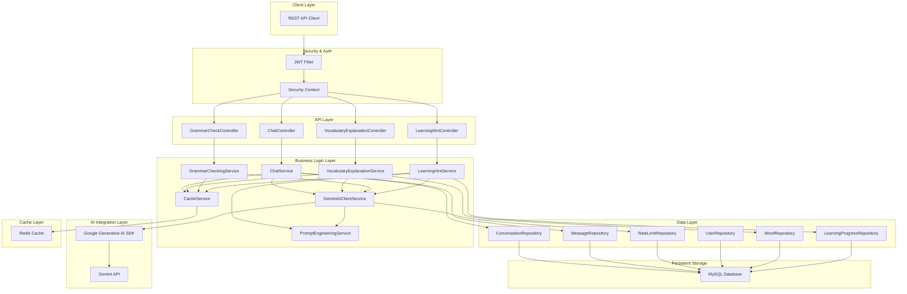
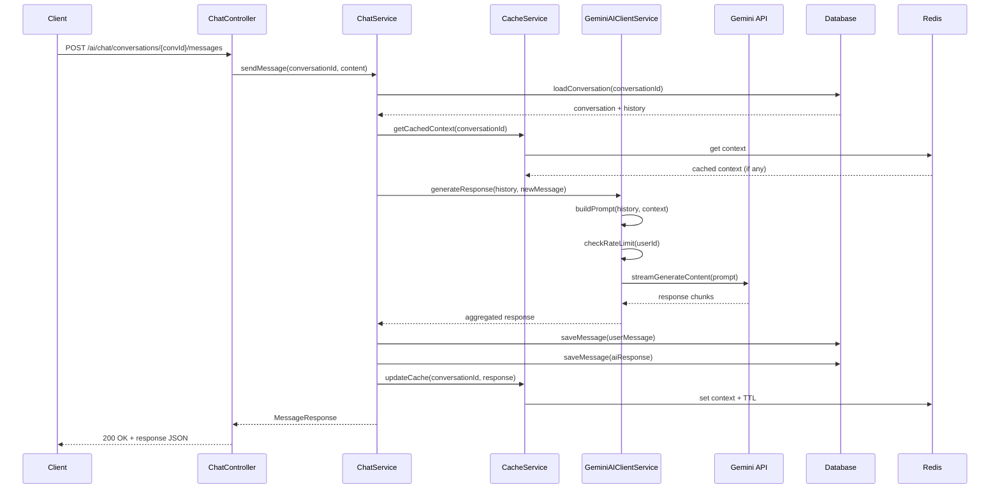
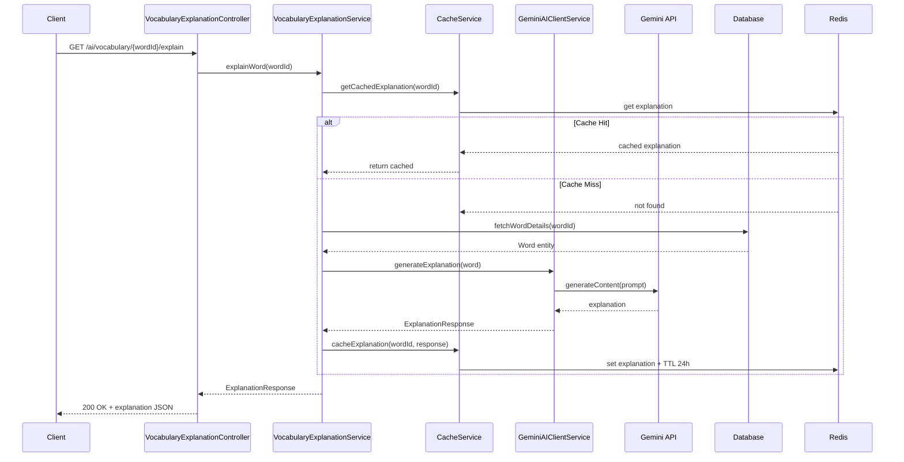

# Design Document: AI Integration with Google Gemini

## Overview

This design establishes a robust AI integration layer with Google Gemini that seamlessly extends VocabularyAI Backend to provide intelligent, context-aware learning features. The integration enables conversational AI chat, intelligent vocabulary explanations, grammar checking, and personalized learning hints—all while maintaining the existing system's reliability and security architecture.

The design follows a modular, package-by-feature approach consistent with the existing codebase, integrating AI capabilities through dedicated services, controllers, and entities while leveraging established patterns for authentication, caching, error handling, and async operations.

## Architecture



## Sequence Diagrams

### AI Chat Service Flow



### Vocabulary Explanation Flow



## Components and Interfaces

### Component 1: ChatService

**Purpose**: Manage conversational AI interactions with Gemini, maintain conversation history, and handle real-time chat messaging.

**Interface**:
```java
@Service
public interface ChatService {
    
    // Start new conversation
    ConversationResponse createConversation(CreateConversationRequest request);
    
    // Send message and get AI response
    MessageResponse sendMessage(Long conversationId, SendMessageRequest request);
    
    // Get conversation with history
    ConversationDetailResponse getConversation(Long conversationId, Integer limit);
    
    // Get user conversations paginated
    Page<ConversationResponse> getUserConversations(Long userId, Pageable pageable);
    
    // Delete conversation
    void deleteConversation(Long conversationId);
    
    // Clear conversation history
    void clearConversationHistory(Long conversationId);
}
```

**Responsibilities**:
- Create and manage conversation sessions
- Store conversation history with timestamps
- Invoke Gemini AI through AIClientService
- Cache conversation context in Redis
- Handle concurrent message processing
- Enforce rate limiting per user
- Manage conversation lifecycle (create, read, delete)

**Thread Safety**:
- Immutable request/response objects
- Repository-level transaction management
- Redis distributed locking for concurrent updates
- Stateless service design

---

### Component 2: VocabularyExplanationService

**Purpose**: Generate AI-powered vocabulary explanations with examples, etymology, and related words.

**Interface**:
```java
@Service
public interface VocabularyExplanationService {
    
    // Get AI explanation for word
    ExplanationResponse explainWord(Long wordId);
    
    // Get explanation for multiple words
    List<ExplanationResponse> explainWords(List<Long> wordIds);
    
    // Get explanation by word text
    ExplanationResponse explainByText(String word);
    
    // Generate custom explanation with context
    ExplanationResponse explainWithContext(Long wordId, String userContext);
}
```

**Responsibilities**:
- Fetch word metadata from database
- Generate comprehensive explanations using Gemini
- Include usage examples, etymology, related words
- Cache explanations with 24-hour TTL
- Support batch explanation generation
- Handle word not found scenarios gracefully

---

### Component 3: GrammarCheckingService

**Purpose**: Check grammar, syntax, and style of user-provided text with detailed feedback.

**Interface**:
```java
@Service
public interface GrammarCheckingService {
    
    // Check grammar in text
    GrammarCheckResponse checkGrammar(GrammarCheckRequest request);
    
    // Get grammar suggestions
    List<GrammarSuggestion> getSuggestions(String text);
    
    // Correct text automatically
    String correctText(String text);
}
```

**Responsibilities**:
- Analyze text for grammatical errors
- Provide correction suggestions with explanations
- Cache common patterns and corrections
- Handle long text with chunking if needed
- Return detailed feedback with examples

---

### Component 4: LearningHintService

**Purpose**: Generate personalized learning hints based on user's progress and word difficulty.

**Interface**:
```java
@Service
public interface LearningHintService {
    
    // Get learning hint for progress
    HintResponse getHint(Long learningProgressId);
    
    // Get contextual hint with user history
    HintResponse getHintWithContext(Long learningProgressId, Integer attemptCount);
    
    // Generate hints for next review items
    List<HintResponse> getHintsForReview(Long userId, Integer count);
}
```

**Responsibilities**:
- Analyze learning progress and difficulty
- Generate personalized, progressive hints
- Incorporate user's learning history and mistakes
- Cache hints with shorter TTL (1 hour)
- Support multiple hint difficulty levels

---

### Component 5: GeminiAIClientService

**Purpose**: Core AI client managing direct communication with Gemini API, prompt engineering, and rate limiting.

**Interface**:
```java
@Service
public interface GeminiAIClientService {
    
    // Generate response with streaming support
    String generateResponse(String prompt, GenerationConfig config);
    
    // Generate with streaming callback
    void generateResponseStream(String prompt, StreamCallback callback);
    
    // Multi-turn conversation
    String generateConversationResponse(List<Message> history, String userMessage);
    
    // Check API rate limits
    boolean isRateLimitExceeded(Long userId);
    
    // Get token count
    int countTokens(String text);
}
```

**Responsibilities**:
- Initialize Gemini SDK with API key
- Build and execute API calls
- Handle streaming responses
- Implement rate limiting per user and globally
- Track API quota and usage
- Implement retry logic with exponential backoff
- Convert responses to domain models

---

### Component 6: PromptEngineeringService

**Purpose**: Build optimized prompts for different use cases with context and formatting.

**Interface**:
```java
@Service
public interface PromptEngineeringService {
    
    // Build chat prompt with history
    String buildChatPrompt(List<Message> history, String newMessage, ConversationType type);
    
    // Build vocabulary explanation prompt
    String buildVocabularyPrompt(Word word, String userContext);
    
    // Build grammar checking prompt
    String buildGrammarPrompt(String text, String context);
    
    // Build learning hint prompt
    String buildHintPrompt(LearningProgress progress, Integer attemptCount);
}
```

**Responsibilities**:
- Craft optimized prompts for different features
- Include context from user history and preferences
- Format prompts for best Gemini performance
- Implement chain-of-thought prompting where appropriate
- Maintain prompt templates

---

### Component 7: CacheService

**Purpose**: Manage Redis caching for AI responses, conversation context, and rate limit data.

**Interface**:
```java
@Service
public interface CacheService {
    
    // Cache operations
    void set(String key, Object value, long ttlSeconds);
    void set(String key, Object value);
    <T> Optional<T> get(String key, Class<T> type);
    void delete(String key);
    
    // Conversation context operations
    void cacheConversationContext(Long conversationId, List<Message> messages, long ttlSeconds);
    Optional<List<Message>> getConversationContext(Long conversationId);
    
    // Explanation cache operations
    void cacheExplanation(Long wordId, ExplanationResponse explanation);
    Optional<ExplanationResponse> getExplanation(Long wordId);
    
    // Rate limit operations
    void incrementRateLimit(String userId, int tokens);
    long getRateLimit(String userId);
}
```

**Responsibilities**:
- Serialize/deserialize domain objects to/from Redis
- Manage cache TTLs for different data types
- Implement cache invalidation strategies
- Handle connection pooling and reconnection
- Provide atomic operations for rate limiting

---

## Data Models

### Entity: Conversation

```java
@Entity
@Table(name = "conversations")
public class Conversation {
    
    @Id
    @GeneratedValue(strategy = GenerationType.IDENTITY)
    private Long id;
    
    @ManyToOne(fetch = FetchType.LAZY)
    @JoinColumn(name = "user_id", nullable = false)
    private User user;
    
    @Column(nullable = false)
    @Enumerated(EnumType.STRING)
    private ConversationType type; // GENERAL, VOCABULARY, GRAMMAR, LEARNING
    
    @Column(length = 255)
    private String title;
    
    @Column(columnDefinition = "LONGTEXT")
    private String summary;
    
    @Column(name = "created_at", nullable = false, updatable = false)
    private LocalDateTime createdAt;
    
    @Column(name = "updated_at")
    private LocalDateTime updatedAt;
    
    @Column(name = "is_archived")
    private Boolean isArchived = false;
    
    @OneToMany(mappedBy = "conversation", cascade = CascadeType.ALL, orphanRemoval = true)
    private List<Message> messages = new ArrayList<>();
    
    // Getters, setters, constructors...
}

enum ConversationType {
    GENERAL,      // General English learning chat
    VOCABULARY,   // Word learning focused
    GRAMMAR,      // Grammar practice
    LEARNING      // Based on learning progress
}
```

**Validation Rules**:
- User must exist and be authenticated
- Type must be valid ConversationType
- Title max 255 characters
- Timestamps auto-managed by JPA
- Cascade delete messages when conversation deleted

---

### Entity: Message

```java
@Entity
@Table(name = "messages")
public class Message {
    
    @Id
    @GeneratedValue(strategy = GenerationType.IDENTITY)
    private Long id;
    
    @ManyToOne(fetch = FetchType.LAZY)
    @JoinColumn(name = "conversation_id", nullable = false)
    private Conversation conversation;
    
    @Column(nullable = false)
    @Enumerated(EnumType.STRING)
    private MessageRole role; // USER, ASSISTANT
    
    @Column(columnDefinition = "LONGTEXT", nullable = false)
    private String content;
    
    @Column(name = "tokens_used")
    private Integer tokensUsed;
    
    @Column(name = "response_time_ms")
    private Long responseTimeMs;
    
    @Column(name = "created_at", nullable = false, updatable = false)
    private LocalDateTime createdAt;
    
    @Column(name = "metadata", columnDefinition = "JSON")
    private String metadata; // JSON for additional data
    
    // Getters, setters, constructors...
}

enum MessageRole {
    USER,
    ASSISTANT
}
```

**Validation Rules**:
- Conversation must exist
- Role must be USER or ASSISTANT
- Content cannot be empty
- Content max 10,000 characters for user, 5,000 for assistant
- CreatedAt auto-set on insert

---

### Entity: RateLimit

```java
@Entity
@Table(name = "rate_limits")
@Index(name = "idx_user_period", columnList = "user_id, period_start")
public class RateLimit {
    
    @Id
    @GeneratedValue(strategy = GenerationType.IDENTITY)
    private Long id;
    
    @ManyToOne(fetch = FetchType.LAZY)
    @JoinColumn(name = "user_id", nullable = false)
    private User user;
    
    @Column(name = "tokens_used", nullable = false)
    private Long tokensUsed = 0L;
    
    @Column(name = "request_count", nullable = false)
    private Integer requestCount = 0;
    
    @Column(name = "period_start", nullable = false)
    private LocalDateTime periodStart;
    
    @Column(name = "period_end", nullable = false)
    private LocalDateTime periodEnd;
    
    @Column(name = "created_at", nullable = false, updatable = false)
    private LocalDateTime createdAt;
    
    @Column(name = "updated_at")
    private LocalDateTime updatedAt;
    
    // Getters, setters, constructors...
}
```

**Validation Rules**:
- User must exist
- Period (24 hours) must be valid date range
- Token limits enforced: 1,000,000 tokens per day per user
- Request limits enforced: 1,000 requests per day per user
- Automatic cleanup of expired records via scheduled task

---

## DTO Models

### Request DTOs

```java
@Data
@NoArgsConstructor
@AllArgsConstructor
@Builder
public class CreateConversationRequest {
    @NotNull
    private ConversationType type;
    
    @NotBlank
    @Size(min = 1, max = 255)
    private String title;
}

@Data
@NoArgsConstructor
@AllArgsConstructor
@Builder
public class SendMessageRequest {
    @NotBlank
    @Size(min = 1, max = 10000)
    private String content;
    
    @Size(max = 500)
    private String context; // Optional context about word, grammar, etc.
}

@Data
@NoArgsConstructor
@AllArgsConstructor
@Builder
public class GrammarCheckRequest {
    @NotBlank
    @Size(min = 1, max = 10000)
    private String text;
    
    @Size(max = 100)
    private String language = "English";
    
    private Boolean includeSuggestions = true;
}
```

### Response DTOs

```java
@Data
@NoArgsConstructor
@AllArgsConstructor
@Builder
public class ConversationResponse {
    private Long id;
    private String title;
    private ConversationType type;
    private LocalDateTime createdAt;
    private LocalDateTime updatedAt;
    private Integer messageCount;
    
    public static ConversationResponse fromEntity(Conversation entity) {
        return ConversationResponse.builder()
            .id(entity.getId())
            .title(entity.getTitle())
            .type(entity.getType())
            .createdAt(entity.getCreatedAt())
            .updatedAt(entity.getUpdatedAt())
            .messageCount(entity.getMessages() != null ? entity.getMessages().size() : 0)
            .build();
    }
}

@Data
@NoArgsConstructor
@AllArgsConstructor
@Builder
public class MessageResponse {
    private Long id;
    private MessageRole role;
    private String content;
    private LocalDateTime createdAt;
    private Integer tokensUsed;
    private Long responseTimeMs;
    
    public static MessageResponse fromEntity(Message entity) {
        return MessageResponse.builder()
            .id(entity.getId())
            .role(entity.getRole())
            .content(entity.getContent())
            .createdAt(entity.getCreatedAt())
            .tokensUsed(entity.getTokensUsed())
            .responseTimeMs(entity.getResponseTimeMs())
            .build();
    }
}

@Data
@NoArgsConstructor
@AllArgsConstructor
@Builder
public class ExplanationResponse {
    private Long wordId;
    private String word;
    private String explanation;
    private List<String> examples;
    private String etymology;
    private List<String> relatedWords;
    private String partOfSpeech;
}

@Data
@NoArgsConstructor
@AllArgsConstructor
@Builder
public class GrammarCheckResponse {
    private String originalText;
    private String correctedText;
    private List<GrammarError> errors;
    private List<GrammarSuggestion> suggestions;
}

@Data
@NoArgsConstructor
@AllArgsConstructor
@Builder
public class GrammarError {
    private Integer startOffset;
    private Integer endOffset;
    private String errorType;
    private String suggestion;
    private String explanation;
}

@Data
@NoArgsConstructor
@AllArgsConstructor
@Builder
public class HintResponse {
    private Long learningProgressId;
    private String hint;
    private Integer hintLevel; // 1=minimal, 2=moderate, 3=detailed
    private List<String> strategies;
    private String explanation;
}
```

---

## API Endpoints

### Chat Service Endpoints

```
POST   /ai/chat/conversations
       Create new conversation
       Request: CreateConversationRequest
       Response: 201 Created - ConversationResponse

GET    /ai/chat/conversations
       Get user's conversations (paginated)
       Query: page, size, sort
       Response: 200 OK - Page<ConversationResponse>

GET    /ai/chat/conversations/{conversationId}
       Get conversation with message history
       Query: limit (default: 50)
       Response: 200 OK - ConversationDetailResponse

POST   /ai/chat/conversations/{conversationId}/messages
       Send message and get AI response
       Request: SendMessageRequest
       Response: 200 OK - MessageResponse

DELETE /ai/chat/conversations/{conversationId}
       Delete conversation
       Response: 204 No Content

DELETE /ai/chat/conversations/{conversationId}/messages
       Clear conversation history (keeps metadata)
       Response: 204 No Content
```

### Vocabulary Explanation Endpoints

```
GET    /ai/vocabulary/{wordId}/explain
       Get AI explanation for word
       Response: 200 OK - ExplanationResponse

POST   /ai/vocabulary/explain/batch
       Get explanations for multiple words
       Request: { wordIds: [1, 2, 3] }
       Response: 200 OK - List<ExplanationResponse>

GET    /ai/vocabulary/explain
       Search and explain by word text
       Query: word
       Response: 200 OK - ExplanationResponse
```

### Grammar Checking Endpoints

```
POST   /ai/grammar/check
       Check grammar in provided text
       Request: GrammarCheckRequest
       Response: 200 OK - GrammarCheckResponse

POST   /ai/grammar/correct
       Get corrected version of text
       Request: { text: "..." }
       Response: 200 OK - { correctedText: "..." }
```

### Learning Hint Endpoints

```
POST   /ai/learning/{learningProgressId}/hint
       Get personalized learning hint
       Query: attemptCount (optional)
       Response: 200 OK - HintResponse

GET    /ai/learning/hints/review
       Get hints for words needing review
       Query: limit (default: 10)
       Response: 200 OK - List<HintResponse>
```

---

## Error Handling

### Error Scenarios

#### Scenario 1: Gemini API Rate Limit Exceeded

**Condition**: User has exceeded daily API quota or rate limit
**HTTP Status**: 429 Too Many Requests
**Response**:
```json
{
  "success": false,
  "message": "Rate limit exceeded",
  "errors": {
    "retryAfter": 3600,
    "quotaReset": "2024-01-01T00:00:00"
  }
}
```
**Recovery**:
- Implement exponential backoff in client
- Return queue position or wait time
- Serve cached responses where available
- Gracefully degrade to suggest alternative learning methods

#### Scenario 2: External Service Unavailable

**Condition**: Gemini API is unreachable or returning 5xx errors
**HTTP Status**: 503 Service Unavailable
**Response**:
```json
{
  "success": false,
  "message": "AI service temporarily unavailable"
}
```
**Recovery**:
- Circuit breaker pattern: fail fast after 5 consecutive failures
- Retry with exponential backoff: 1s, 2s, 4s, 8s, 16s
- Fallback to cached responses with staleness flag
- Log detailed error for monitoring and alerting
- Notify user and suggest manual alternative

#### Scenario 3: Invalid or Malformed Text

**Condition**: User provides empty, null, or excessively long text
**HTTP Status**: 400 Bad Request
**Response**:
```json
{
  "success": false,
  "message": "Invalid input",
  "errors": {
    "text": "Text must be between 1 and 10000 characters"
  }
}
```
**Recovery**:
- Validate all inputs before sending to AI
- Return specific field-level errors
- Suggest corrected input when possible

#### Scenario 4: Conversation Not Found

**Condition**: User requests conversation that doesn't exist or belongs to another user
**HTTP Status**: 404 Not Found (or 403 Forbidden if unauthorized)
**Response**:
```json
{
  "success": false,
  "message": "Conversation not found"
}
```
**Recovery**:
- Verify conversation ID and user ownership
- Log access attempt for security monitoring
- Suggest creating new conversation

#### Scenario 5: Word Not Found for Explanation

**Condition**: Requested word ID doesn't exist in database
**HTTP Status**: 404 Not Found
**Response**:
```json
{
  "success": false,
  "message": "Word not found"
}
```
**Recovery**:
- Return list of similar words if available
- Suggest general AI chat for explanation

---

## Custom Exceptions

```java
/**
 * Thrown when AI service operation fails
 * Includes retry information and fallback suggestions
 */
public class AIException extends RuntimeException {
    private final String aiService;
    private final Integer retryAfterSeconds;
    private final boolean isRetryable;
    
    public AIException(String message, Throwable cause, String aiService, boolean isRetryable) {
        super(message, cause);
        this.aiService = aiService;
        this.isRetryable = isRetryable;
        this.retryAfterSeconds = isRetryable ? 5 : null;
    }
}

/**
 * Thrown when external service (Gemini API) is unavailable
 */
public class ExternalServiceException extends RuntimeException {
    private final String serviceName;
    private final Integer retryAfterSeconds;
    
    public ExternalServiceException(String message, String serviceName, Integer retryAfterSeconds) {
        super(message);
        this.serviceName = serviceName;
        this.retryAfterSeconds = retryAfterSeconds;
    }
}

/**
 * Thrown when rate limit is exceeded
 */
public class RateLimitExceededException extends RuntimeException {
    private final Long resetTimeUnix;
    private final String limitType; // DAILY, HOURLY, etc.
    
    public RateLimitExceededException(String message, Long resetTimeUnix, String limitType) {
        super(message);
        this.resetTimeUnix = resetTimeUnix;
        this.limitType = limitType;
    }
}
```

---

## Correctness Properties

*A property is a characteristic or behavior that should hold true across all valid executions of a system—essentially, a formal statement about what the system should do. Properties serve as the bridge between human-readable requirements and machine-verifiable correctness guarantees. Each property below is directly traceable to the corresponding requirement(s) in the requirements document.*

### Property 1: Conversation Isolation and Ownership

*For any* conversation stored in the system and any user, a conversation belongs exclusively to its owning user.

```
∀ conversation ∈ conversations, ∀ user ∈ users:
  user.id != conversation.userId ⟹ user CANNOT access conversation
```

**Validates: Requirements 2.1, 3.1, 4.1, 5.1, 34**

**Test Strategy**: Property-based test generating random conversations and users, verifying that only the conversation owner can retrieve/modify it.

---

### Property 2: Message Ownership and Association

*For any* message in the database, the message belongs to its parent conversation and cannot be orphaned.

```
∀ message ∈ messages:
  ∃ conversation ∈ conversations, conversation.id == message.conversation_id
```

**Validates: Requirements 2.3, 2.6, 3.2, 38**

**Test Strategy**: Property test generating messages and verifying all messages have valid conversation references.

---

### Property 3: Message Ordering Consistency

*For any* conversation, messages are always ordered chronologically by creation timestamp in ascending order.

```
∀ conversation ∈ conversations, ∀ messages ∈ conversation.getMessages():
  ∀ i,j ∈ [0, len(messages)): i < j ⟹ messages[i].createdAt <= messages[j].createdAt
```

**Validates: Requirements 3.2, 3.5**

**Test Strategy**: Property test generating conversations with messages, retrieving them, and verifying ordering.

---

### Property 4: Authorization Enforcement Completeness

*For any* read, update, or delete operation on a conversation, the system verifies user authorization before returning data or making modifications.

```
∀ operation ∈ {read, update, delete}, ∀ resource ∈ {Conversation, Message}:
  authorize(user, operation, resource) must be called before execution
```

**Validates: Requirements 2.1, 2.9, 3.1, 4.1, 5.1, 5.5, 34**

**Test Strategy**: Example-based tests for authorization checks with authorized and unauthorized users.

---

### Property 5: Rate Limit Enforcement Accuracy

*For any* user within a 24-hour period, if tokens_used + estimated_tokens exceeds the daily limit, the request is rejected with HTTP 429.

```
∀ user ∈ users, ∀ period ∈ periods:
  (rateLimit(user, period).tokens_used + estimatedTokens(request) > DAILY_LIMIT)
    ⟹ response.status == 429
```

**Validates: Requirements 20, 21, 42**

**Test Strategy**: Property test with varying token counts, verifying rejection at limit boundaries.

---

### Property 6: Rate Limit Counter Atomicity

*For any* rate limit update, the increment operation is atomic—no lost updates occur even under concurrent requests.

```
∀ user ∈ users, ∀ concurrent_requests ∈ [1..N]:
  sum(tokensIncremented) == sum(actualTokens)
```

**Validates: Requirements 20, 30**

**Test Strategy**: Concurrent property test with multiple threads updating rate limit, verifying accuracy.

---

### Property 7: Cache Expiration Enforcement

*For any* cached item, if current_time >= cache_set_time + TTL, the item is not returned from cache.

```
∀ cached_item ∈ cache, ∀ t ≥ (item.createdAt + item.TTL):
  cache.get(item.key) returns empty
```

**Validates: Requirements 26, 27, 29, 43**

**Test Strategy**: Property test with time-based generators, verifying expiration behavior.

---

### Property 8: Message Content Length Constraint

*For any* message content submitted by a user, the content length after trimming is between 1 and 10,000 characters, or the request is rejected.

```
∀ content ∈ submitted_content:
  (len(content.trim()) >= 1 AND len(content.trim()) <= 10000) OR response.status == 400
```

**Validates: Requirements 2.2, 35, 59**

**Test Strategy**: Property test with string generators for empty, valid, and oversized content.

---

### Property 9: Conversation Title Length Constraint

*For any* conversation creation request, if the title exceeds 255 characters, the request is rejected with HTTP 400.

```
∀ request ∈ createConversationRequests:
  len(request.title) > 255 ⟹ response.status == 400
```

**Validates: Requirements 1.5, 35, 57**

**Test Strategy**: Edge case test with title length at boundaries (254, 255, 256 chars).

---

### Property 10: Conversation Type Validation

*For any* conversation creation, if the type is not one of the valid enum values (GENERAL, VOCABULARY, GRAMMAR, LEARNING), the request is rejected.

```
∀ type ∈ submitted_type:
  type ∉ {GENERAL, VOCABULARY, GRAMMAR, LEARNING} ⟹ response.status == 400
```

**Validates: Requirements 1.4, 37, 57**

**Test Strategy**: Example test with invalid types, verifying rejection.

---

### Property 11: Message History Persistence Round-Trip

*For any* message sent to a conversation, the exact message content is retrievable from the database without loss or modification.

```
∀ message ∈ sent_messages:
  send_message(user, conv, message.content)
    ⟹ retrieve_message(conv).content == message.content
```

**Validates: Requirements 2.3, 2.6, 3.2, 3.5**

**Test Strategy**: Round-trip property test generating random messages, storing, and retrieving.

---

### Property 12: Cascade Delete Completeness

*For any* conversation deletion, all associated messages are deleted from the database.

```
∀ conversation ∈ conversations_to_delete:
  delete(conversation) ⟹ ∀ message ∈ messages(conversation), ¬exists(message)
```

**Validates: Requirements 5.2, 38**

**Test Strategy**: Property test creating conversations with messages, deleting, and verifying message absence.

---

### Property 13: Cache Invalidation Completeness

*For any* conversation deletion, all cache entries for that conversation are removed.

```
∀ conversation_id ∈ deleted_conversations:
  delete(conversation) ⟹ cache.get(ai:conv:context:{conversation_id}) returns empty
```

**Validates: Requirements 5.3, 6.3, 28, 29**

**Test Strategy**: Property test verifying cache entries are cleared after invalidation.

---

### Property 14: Explanation Response Completeness

*For any* vocabulary explanation response, all required fields (word, definition, examples, etymology, related_words, part_of_speech) are present.

```
∀ explanation ∈ explanationResponses:
  hasField(explanation, 'word') AND 
  hasField(explanation, 'definition') AND 
  hasField(explanation, 'examples') AND 
  hasField(explanation, 'etymology') AND 
  hasField(explanation, 'relatedWords') AND 
  hasField(explanation, 'partOfSpeech')
```

**Validates: Requirements 7.6, 7.8, 8**

**Test Strategy**: Property test generating explanations and verifying all fields are present.

---

### Property 15: Grammar Check Error Consistency

*For any* grammar check result, all reported errors have valid positions (startOffset <= endOffset) and suggestions.

```
∀ error ∈ grammarCheckResponse.errors:
  error.startOffset >= 0 AND 
  error.endOffset >= error.startOffset AND 
  len(error.suggestion) > 0
```

**Validates: Requirements 11, 12**

**Test Strategy**: Property test generating grammar check results, verifying error structure consistency.

---

### Property 16: Token Count Consistency

*For any* API call, the token count recorded is non-negative and matches the estimated token count.

```
∀ call ∈ apiCalls:
  tokensRecorded(call) >= 0 AND 
  tokensRecorded(call) ≈ estimatedTokens(call.prompt)
```

**Validates: Requirements 17, 19, 21**

**Test Strategy**: Property test with varying prompt sizes, verifying token counting accuracy.

---

### Property 17: Pagination Limit Enforcement

*For any* paginated request with a limit parameter, the response contains at most {limit} items.

```
∀ page ∈ paginatedResponses:
  len(page.content) <= page.limit
```

**Validates: Requirements 3.3, 4.2, 4.3**

**Test Strategy**: Property test generating pagination requests with various limits, verifying count enforcement.

---

### Property 18: Input Sanitization Effectiveness

*For any* user input processed by InputSanitizer, control characters are removed and multiple spaces are collapsed.

```
∀ input ∈ userInput:
  sanitized = sanitize(input)
  hasControlCharacters(sanitized) == false AND 
  multipleConsecutiveSpaces(sanitized) == false
```

**Validates: Requirements 36, 48**

**Test Strategy**: Property test with inputs containing control characters and multiple spaces.

---

### Property 19: Cache Consistency After Invalidation

*For any* cache invalidation operation, the cache item is not retrievable after invalidation, even if subsequent requests are made.

```
∀ key ∈ invalidatedKeys:
  invalidate(key) ⟹ 
  ∀ t > invalidation_time, cache.get(key) returns empty
```

**Validates: Requirements 28, 29**

**Test Strategy**: Property test invalidating cache and verifying subsequent gets fail.

---

### Property 20: User Context Preservation in Responses

*For any* API response, the authenticated user ID in the security context matches the requesting user.

```
∀ response ∈ apiResponses:
  SecurityContext.getUser().id == response.associatedUserId
```

**Validates: Requirements 2.1, 3.1, 4.1, 34**

**Test Strategy**: Property test verifying user context is correctly propagated.

---

## Testing Strategy

### Unit Testing Approach

**Test Coverage**: 80%+ for service layer

**Test Categories**:

1. **Chat Service Tests**
   - Create conversation with valid/invalid types
   - Send messages and verify AI response format
   - Verify conversation isolation and security
   - Test message limit enforcement
   - Test conversation deletion cascade

2. **AI Client Service Tests**
   - Mock Gemini API responses
   - Verify prompt construction
   - Test rate limit increment/check
   - Test token counting accuracy
   - Verify error handling and retries

3. **Cache Service Tests**
   - Test set/get operations with TTL
   - Test serialization/deserialization
   - Verify cache invalidation
   - Test rate limit atomic operations

4. **Prompt Engineering Tests**
   - Verify prompt format consistency
   - Test context injection
   - Verify special character escaping
   - Test token count accuracy

### Property-Based Testing Approach

**Property Test Library**: fast-check (Java version)

**Generators**:
- `string(1, 10000)` for message content
- `integer(1, 1000)` for pagination
- `oneof(GENERAL, VOCABULARY, GRAMMAR, LEARNING)` for conversation types

**Properties to Verify**:
1. Message content never exceeds 10,000 chars after trimming
2. Conversation ID is always positive integer
3. User ID matches authenticated user in context
4. Rate limit tokens always non-negative
5. Message timestamps are monotonically increasing within conversation

### Integration Testing Approach

**Test Scenarios**:
1. End-to-end chat conversation with persistence
2. Vocabulary explanation with cache hit/miss
3. Grammar checking with multiple error types
4. Learning hints with user history context
5. Rate limit enforcement across concurrent requests
6. Authorization and access control
7. Error handling and graceful degradation

---

## Caching Strategy

### Cache Key Patterns

```
# Conversation context
ai:conv:context:{conversationId} -> List<Message>
  TTL: 30 minutes (extends on access)
  Size Limit: 100KB per conversation

# Explanation cache
ai:explain:{wordId} -> ExplanationResponse
  TTL: 24 hours
  Size Limit: 10KB per explanation

# Grammar check cache (hash-based to handle arbitrary text)
ai:grammar:{textHash} -> GrammarCheckResponse
  TTL: 1 hour (common patterns)
  Size Limit: 5KB per check

# Hint cache
ai:hint:{learningProgressId}:{attemptCount} -> HintResponse
  TTL: 1 hour
  Size Limit: 2KB per hint

# Rate limit counters
ai:ratelimit:{userId}:{period} -> RateLimitData
  TTL: Period expiry + 1 minute
  Size Limit: 100 bytes per user

# Prompt cache (for repeated patterns)
ai:prompt:hash:{promptHash} -> Response
  TTL: 6 hours
  Size Limit: 5KB per prompt
```

### Cache Invalidation

- **On Update**: Delete related cache entries (e.g., word update deletes explanation)
- **Explicit**: Admin endpoint to clear caches
- **TTL-based**: Redis handles automatic expiration
- **Cascade**: Deleting conversation deletes its cached context
- **Smart Refresh**: Update cache on successful response (write-through)

### Cache Hit/Miss Metrics

- Track hit rates per feature (target: >70%)
- Monitor cache eviction due to memory pressure
- Alert if miss rate exceeds 40%
- Log cache operations for debugging

---

## Rate Limiting and Quota Management

### Rate Limit Tiers

```
Free Tier (per 24-hour period):
- 100 API requests
- 50,000 tokens
- 10 conversations
- 5 concurrent requests

Premium Tier:
- 1,000 API requests
- 500,000 tokens
- Unlimited conversations
- 20 concurrent requests

Enterprise Tier:
- Unlimited requests
- Unlimited tokens
- Custom quotas
```

### Implementation

**Database Tracking**:
```sql
CREATE TABLE rate_limits (
    id BIGINT PRIMARY KEY AUTO_INCREMENT,
    user_id BIGINT NOT NULL,
    tokens_used BIGINT NOT NULL DEFAULT 0,
    request_count INT NOT NULL DEFAULT 0,
    period_start DATETIME NOT NULL,
    period_end DATETIME NOT NULL,
    created_at TIMESTAMP DEFAULT CURRENT_TIMESTAMP,
    updated_at TIMESTAMP DEFAULT CURRENT_TIMESTAMP ON UPDATE CURRENT_TIMESTAMP,
    UNIQUE KEY uk_user_period (user_id, period_start),
    FOREIGN KEY (user_id) REFERENCES users(id) ON DELETE CASCADE
);
```

**In-Memory Caching** (Redis):
```
ai:ratelimit:{userId}:{period} = {
    tokens_used: Long,
    request_count: Int,
    period_start: Timestamp,
    period_end: Timestamp
}
```

**Enforcement Points**:
1. Before sending request to Gemini API
2. Check both request count and token limits
3. Return 429 if exceeded with `Retry-After` header
4. Increment counters atomically after successful API call

---

## Configuration

### Application Properties

```yaml
# application-prod.yml

spring:
  ai:
    google:
      gemini:
        api-key: ${GEMINI_API_KEY}
        model: gemini-1.5-pro-latest
        max-output-tokens: 2048
        temperature: 0.7
        top-p: 0.95
        top-k: 40
        
# Rate limiting configuration
app:
  ai:
    rate-limit:
      enabled: true
      daily-tokens: 1000000
      daily-requests: 1000
      hourly-burst: 100
      cleanup-interval: 3600 # seconds
      
    cache:
      enabled: true
      default-ttl: 3600 # seconds
      conversation-ttl: 1800
      explanation-ttl: 86400
      
    gemini:
      request-timeout: 30 # seconds
      connect-timeout: 10
      max-retries: 3
      retry-backoff-multiplier: 2.0
      
    features:
      chat-enabled: true
      grammar-check-enabled: true
      vocabulary-explain-enabled: true
      learning-hints-enabled: true
```

---

## Async Operations

### Use Cases

1. **AI Response Generation**: Long-running API calls
2. **Conversation History Cleanup**: Batch operations
3. **Cache Warming**: Pre-generating common explanations
4. **Analytics**: Tracking feature usage asynchronously

### Implementation

```java
@Service
@EnableAsync
public class AsyncAIService {
    
    @Async
    public CompletableFuture<MessageResponse> generateResponseAsync(
            Long conversationId, String content) {
        // Long-running AI operation
        return CompletableFuture.completedFuture(response);
    }
    
    @Async
    public void cleanupConversationHistoryAsync(Long conversationId) {
        // Background cleanup
    }
    
    @Async
    public void warmCacheAsync(List<Long> wordIds) {
        // Pre-generate and cache explanations
    }
}

// Executor configuration
@Configuration
@EnableAsync
public class AsyncConfig {
    
    @Bean(name = "aiExecutor")
    public Executor aiExecutor() {
        ThreadPoolTaskExecutor executor = new ThreadPoolTaskExecutor();
        executor.setCorePoolSize(10);
        executor.setMaxPoolSize(20);
        executor.setQueueCapacity(100);
        executor.setThreadNamePrefix("ai-");
        executor.initialize();
        return executor;
    }
}
```

---

## Security and Authorization

### Authentication Flow

1. User authenticates via JWT (existing auth system)
2. JWT token included in Authorization header
3. JwtAuthenticationFilter validates token
4. SecurityContext holds authenticated user
5. Controllers access via `@AuthenticationPrincipal`

### Authorization Rules

**Conversation Access**:
```java
@PreAuthorize("hasRole('USER')")
@PostMapping("/ai/chat/conversations")
public ResponseEntity<?> createConversation(@Valid @RequestBody CreateConversationRequest request) {
    Long userId = SecurityUtils.getCurrentUserId();
    return ResponseEntity.ok(chatService.createConversation(userId, request));
}

@PreAuthorize("hasRole('USER')")
@GetMapping("/ai/chat/conversations/{conversationId}")
public ResponseEntity<?> getConversation(@PathVariable Long conversationId) {
    Long userId = SecurityUtils.getCurrentUserId();
    Conversation conv = conversationRepository.findById(conversationId)
        .orElseThrow(() -> new ResourceNotFoundException(...));
    
    if (!conv.getUser().getId().equals(userId)) {
        throw new ForbiddenException("Access denied");
    }
    
    return ResponseEntity.ok(ConversationResponse.fromEntity(conv));
}
```

### Input Validation and Sanitization

```java
@Service
public class InputSanitizer {
    
    public String sanitizeText(String text) {
        return text
            .trim()
            .replaceAll("\\s+", " ")
            .replaceAll("[\\x00-\\x08\\x0B-\\x0C\\x0E-\\x1F]", "");
    }
    
    public void validatePromptLength(String prompt) {
        if (prompt == null || prompt.isBlank()) {
            throw new ValidationException("Prompt cannot be empty");
        }
        if (prompt.length() > 10000) {
            throw new ValidationException("Prompt exceeds maximum length");
        }
    }
}
```

---

## Monitoring and Logging

### Key Metrics

```java
@Component
public class AIMeterRegistry {
    
    private final MeterRegistry meterRegistry;
    
    // API call metrics
    Counter geminiApiCalls = Counter.builder("ai.gemini.calls")
        .tag("feature", "unknown")
        .register(meterRegistry);
    
    Timer geminiResponseTime = Timer.builder("ai.gemini.response_time")
        .publishPercentiles(0.5, 0.95, 0.99)
        .register(meterRegistry);
    
    // Cache metrics
    Counter cacheHits = Counter.builder("ai.cache.hits").register(meterRegistry);
    Counter.builder("ai.cache.misses").register(meterRegistry);
    
    // Rate limit metrics
    Gauge.builder("ai.rate_limit.usage", () -> totalTokensUsed)
        .register(meterRegistry);
    
    // Error metrics
    Counter aiErrors = Counter.builder("ai.errors")
        .tag("type", "unknown")
        .register(meterRegistry);
}
```

### Logging Levels

```java
@Service
@Slf4j
public class ChatService {
    
    public void sendMessage(Long conversationId, String content) {
        log.info("Processing message for conversation: {}", conversationId);
        
        try {
            // Business logic
            log.debug("Message content: {}", content);
            
        } catch (AIException e) {
            log.error("AI service failed for conversation: {}", conversationId, e);
            // Handle error
        }
    }
}
```

### Alerts

- AI API error rate > 5%
- Average response time > 10 seconds
- Cache hit rate < 50%
- Rate limit exceeded events
- Gemini API quota near limit (>80%)

---

## Dependencies

### New Dependencies to Add (in pom.xml)

```xml
<!-- Google Generative AI SDK -->
<dependency>
    <groupId>com.google.ai.client.generativeai</groupId>
    <artifactId>google-generativeai</artifactId>
    <version>0.4.0</version>
</dependency>

<!-- Apache Commons Lang for utilities -->
<dependency>
    <groupId>org.apache.commons</groupId>
    <artifactId>commons-lang3</artifactId>
    <version>3.14.0</version>
</dependency>
```

### Existing Dependencies Used

- `spring-boot-starter-web`: REST endpoints
- `spring-boot-starter-data-jpa`: Database operations
- `spring-boot-starter-security`: Authentication/Authorization
- `spring-boot-starter-data-redis`: Redis caching
- `spring-boot-starter-validation`: Input validation
- `lombok`: Annotations for boilerplate reduction
- `mapstruct`: DTO mapping
- `jjwt`: JWT handling
- `jackson-databind`: JSON serialization

---

## Performance Considerations

### Optimization Strategies

1. **Lazy Loading**: Use `FetchType.LAZY` on associations
2. **Query Optimization**: Use custom repository methods with `@Query` for efficient joins
3. **Batch Operations**: Process multiple items together
4. **Connection Pooling**: Configured in Spring
5. **Pagination**: Limit API responses to prevent memory overload
6. **Caching**: Multi-level caching (Redis, local)

### Expected Performance

- Chat response time: 1-5 seconds (including Gemini API latency)
- Vocabulary explanation: 2-3 seconds (cached: <100ms)
- Grammar check: 2-4 seconds (cached patterns: <100ms)
- Cache hit operations: <10ms
- Database queries: <50ms average

---

## Deployment Considerations

### Environment Variables Required

```
GEMINI_API_KEY=sk-...              # Google Gemini API key
SPRING_DATASOURCE_URL=mysql://...  # MySQL connection
SPRING_REDIS_URL=redis://...       # Redis connection
APP_AI_ENABLED=true                # Enable/disable AI features
```

### Docker Configuration (optional)

```dockerfile
FROM openjdk:21-slim
WORKDIR /app
COPY target/vocabulary-ai-backend-1.0.0.jar app.jar
ENV GEMINI_API_KEY=${GEMINI_API_KEY}
ENV SPRING_PROFILES_ACTIVE=prod
EXPOSE 8080
ENTRYPOINT ["java", "-jar", "app.jar"]
```

### Database Migrations (Flyway)

Location: `src/main/resources/db/migration/`

Files:
- `V7__Create_ai_tables.sql` - Conversations, Messages, RateLimits
- `V8__Add_ai_indexes.sql` - Performance indexes
- `V9__Add_ai_audit_tables.sql` - Audit logging

---

## Failure Modes and Mitigation

### Failure Mode 1: Gemini API Permanently Unavailable

**Impact**: All AI features non-functional
**Mitigation**:
- Circuit breaker: Fast-fail after threshold
- Cache fallback for recent requests
- Graceful degradation message to users
- Manual intervention: Disable feature flag temporarily

### Failure Mode 2: Redis Cache Failure

**Impact**: Cache unavailable, fallback to DB, performance degradation
**Mitigation**:
- Automatic cache bypass if unavailable
- Connection reconnection with backoff
- Metrics tracking for cache availability

### Failure Mode 3: Rate Limit False Positive

**Impact**: Legitimate user blocked
**Mitigation**:
- Generous initial limits
- Admin override capability
- Monitoring for unusual patterns
- User appeal process

### Failure Mode 4: Message Loss During Persistence

**Impact**: User loses message history
**Mitigation**:
- Transactional writes
- WAL (Write-Ahead Logging) in MySQL
- Backup and replication strategy

---

## Future Enhancements

1. **Multi-language Support**: Support non-English languages
2. **Advanced Analytics**: User learning patterns and effectiveness metrics
3. **Custom AI Models**: Fine-tuned models for specific domains
4. **Voice Integration**: Speech-to-text for conversation
5. **Collaborative Learning**: Group chat with AI moderation
6. **Export Functionality**: Download conversations and explanations as PDF
7. **AI Model Selection**: Allow users to choose between different models
8. **Context Awareness**: Deep integration with user learning history
9. **Conversation Branching**: Explore alternative conversation paths
10. **Feedback Loop**: User ratings to improve AI responses

---

## Technology Stack Summary

| Component | Technology | Version |
|-----------|-----------|---------|
| Framework | Spring Boot | 3.3.0 |
| Language | Java | 21 |
| Database | MySQL | 8.3+ |
| Cache | Redis | Latest |
| AI Service | Google Gemini | Latest API |
| ORM | JPA/Hibernate | 6.x |
| Build Tool | Maven | 3.11+ |
| Authentication | JWT (JJWT) | 0.12.5 |
| Mapping | MapStruct | 1.5.5 |
| Utilities | Lombok | 1.18.30 |
| API Docs | Springdoc OpenAPI | 2.4.0 |

